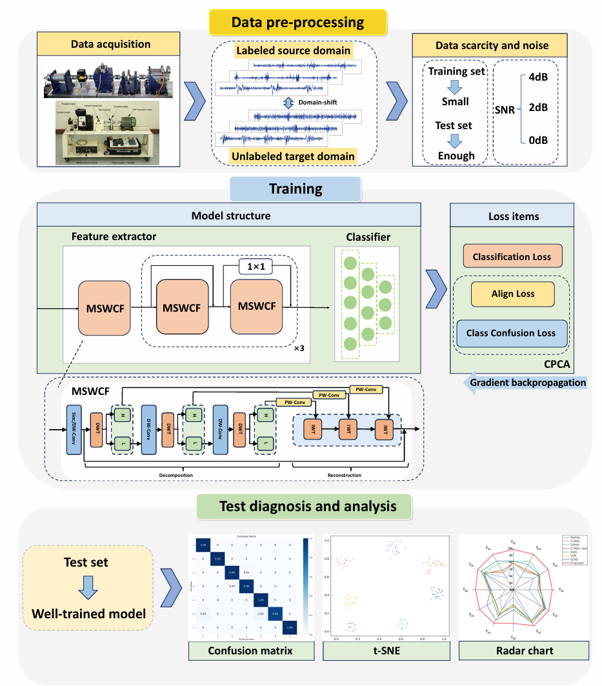

# WDCN: A Wavelet-Driven Contrastive Network for Cross-Domain Fault Diagnosis under Data Scarcity and Noise
* Core codes for the paper:
* WDCN: A Wavelet-Driven Contrastive Network for Cross-Domain Fault Diagnosis under Data Scarcity and Noise

## Operating environment
* python 3.9.20
* pytorch 2.5.1
* numpy 1.26.4
* and other necessary libs

(We will further update relevent information if the paper is accepted for publication!)
